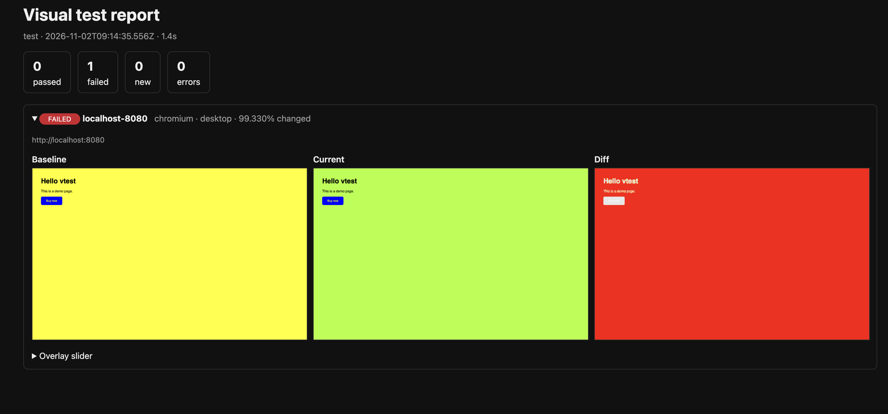
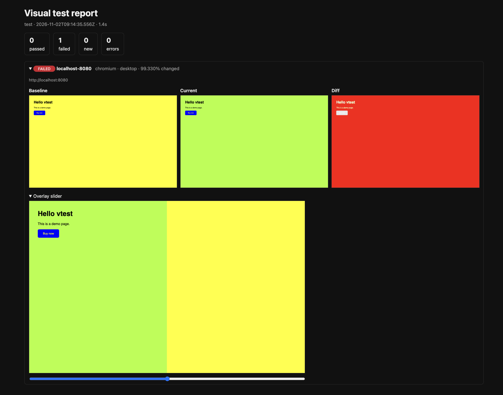
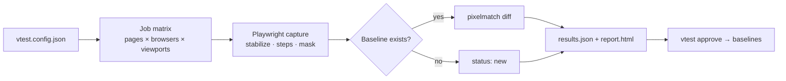

# vtest - URL-driven visual regression testing with Playwright + TypeScript

A small, dependency-light CLI that does visual testing for **any web app you can reach by URL** — no changes to the app's code required. Point it at pages, approve a baseline, and from then on every run tells you exactly which pages changed and how.

```bash
vtest init                 # create a config
vtest baseline             # capture the "known good" screenshots
vtest test                 # diff the current app against them
vtest approve              # accept intentional changes
```



_A failed run: the page background changed from `yellow` to `greenyellow`. The report shows the summary counts, the baseline, current and diff images, and an overlay slider that lets you drag between the old and new versions. The run exits with code 1._

## Features

- **Zero app changes** – drives a real browser (Chromium, Firefox, WebKit) via Playwright.
- **Matrix runs** – pages × browsers × viewports from one config file.
- **Noise control** – animations disabled, carets hidden, fonts/images awaited, lazy content triggered, optional frozen clock, `mask` (paint over) and `hide` (visibility) selectors, custom CSS injection.
- **Interaction steps** – click, fill, hover, press keys and wait before capturing, so you can test modals, menus and logged-in states.
- **Auth support** – reuse a Playwright `storageState` session file and/or custom headers.
- **Pixel diffing** – [pixelmatch](https://github.com/mapbox/pixelmatch) with per-pixel tolerance _and_ a max changed-pixel ratio; size changes are detected and highlighted.
- **HTML report** – baseline / current / diff side by side, plus an overlay slider. Failures sort to the top.
- **Environment comparison** – `vtest compare <urlA> <urlB>` diffs staging vs. production with no stored baselines.
- **CI-ready** – exit codes, GitHub Actions workflow and Docker image included.

## Quick start

Requirements: Node.js 18.18+.

```bash
git clone https://github.com/<your-username>/vtest-playwright.git
cd vtest-playwright
npm install                         # installs dependencies (required before build)
npx playwright install chromium     # add firefox / webkit if you use them
npm run build                       # compiles TypeScript to dist/
npm test                            # unit tests for the diff engine
```

Run all commands from the folder that contains `package.json`.

## Try it: 5-minute walkthrough

This repo ships with a tiny demo page (`demo/index.html`) so you can see the whole workflow, including a failing test, without needing a real app.

> You need **two terminals** open in the project folder: one keeps the demo page running, the other runs `vtest`.
> `vtest` itself is a command-line tool; it runs, prints results and exits.

### Terminal 1: serve the demo page

```bash
npm run demo
# same as: python3 -m http.server 8080 --directory demo
```

It prints `Serving HTTP on :: port 8080` and then looks like it hangs. That is normal. **Leave it running.** Open http://localhost:8080 in a browser to check you can see "Hello vtest" and a blue button.

(No Python? Use `npx http-server demo -p 8080` instead.)

### Terminal 2: run vtest

**1. Capture the baseline**

```bash
node dist/cli.js baseline --url http://localhost:8080
```

Expected output:

```
Capturing 1 baseline image(s)...
  ✓ localhost-8080__chromium__desktop

Saved 1 baseline(s) to .vtest/baselines
```

Check it exists and looks right:

```bash
ls .vtest/baselines
open .vtest/baselines/localhost-8080__chromium__desktop.png    # macOS (Linux: xdg-open, Windows: start)
```

**2. Test with no changes (should pass)**

```bash
node dist/cli.js test --url http://localhost:8080
```

```
1 passed, 0 failed, 0 new, 0 errors
Report: .../.vtest/output/report.html
```

**3. Break something on purpose**

The demo page currently has a yellow background (`background: yellow;` in `demo/index.html`), and that is what the baseline captured. Change it to a different colour:

```css
body {
  font-family: sans-serif;
  margin: 40px;
  background: greenyellow;
}
```

Save the file (you do **not** need to restart the server or recapture the baseline), then run the test again:

```bash
node dist/cli.js test --url http://localhost:8080
```

```
0 passed, 1 failed, 0 new, 0 errors  (1.4s)
  FAILED  localhost-8080__chromium__desktop  99.330% changed
```

The command exits with code `1`, which is what makes a CI pipeline fail. The background covers almost the whole page, hence the ~99% changed.

> **Why a small change may still pass:** a run only fails when more than `maxDiffRatio` of the pixels changed (default `0.001`, i.e. 0.1%). Changing just the text colour of "Buy now" touches a few hundred pixels, which is under that limit. For strict comparison set `"maxDiffRatio": 0` in `vtest.config.json`. See [Choosing a value](#choosing-maxdiffratio).

**4. Open the report**

```bash
open .vtest/output/report.html
```

You should see something like this:



- **Baseline** is the stored reference (yellow background).
- **Current** is what the app looks like now (greenyellow background).
- **Diff** highlights what changed. See [Reading the diff image](#reading-the-diff-image) below.
- **Overlay slider** (expand it under the images) stacks the two captures on top of each other. Drag the slider to reveal the current capture on the left and the baseline on the right, so you can spot exactly where things moved or changed colour.


**5. Approve the change**

```bash
node dist/cli.js approve
node dist/cli.js test --url http://localhost:8080     # passes again
```

**6. (Optional) Compare two environments**

Serve a modified copy of the demo on a second port and diff the two live sites, with no stored baselines:

```bash
cp -r demo demo-b          # edit demo-b/index.html to change something
python3 -m http.server 8081 --directory demo-b      # in a third terminal
node dist/cli.js compare http://localhost:8080 http://localhost:8081
open .vtest/output/compare/report.html
```

**7. (Optional) Use a config file for multiple pages and viewports**

```bash
node dist/cli.js init       # creates vtest.config.json
```

Set `"baseUrl": "http://localhost:8080"`, add more pages/viewports, then run `baseline` and `test` without `--url`.

### Quick reference: "did it work?"

| Check           | Command                                           | Expected                                               |
| --------------- | ------------------------------------------------- | ------------------------------------------------------ |
| Baseline exists | `ls .vtest/baselines`                             | a `.png` per page/browser/viewport                     |
| Unchanged app   | `node dist/cli.js test --url ...`                 | `1 passed, 0 failed`                                   |
| Changed app     | same command after changing the background colour | `1 failed`, `99.330% changed`, exit code 1 (`echo $?`) |
| Report          | `open .vtest/output/report.html`                  | baseline / current / diff images                       |
| After approve   | `node dist/cli.js approve` then `test`            | passes again                                           |

### Reading the diff image

The diff is drawn by [pixelmatch](https://github.com/mapbox/pixelmatch) using its default colours:

| Colour in the diff     | Meaning                                                                                                                          |
| ---------------------- | -------------------------------------------------------------------------------------------------------------------------------- |
| **Red**                | The pixel changed by more than the `threshold` tolerance (default `0.1`). These are the pixels that count towards the failure.   |
| **Yellow**             | The pixel looks like anti-aliasing (soft edges of text and shapes) and is ignored, so it does not count as a change.             |
| **Faded white / gray** | The pixel is identical in both images. It is drawn as a washed-out copy of the original so you can still see the page structure. |

In the screenshot above, the yellow-to-greenyellow background changed on almost every pixel, so almost the entire diff is red. The only areas that are _not_ red are the black heading and paragraph text and the blue button, which are identical in both captures. They appear as a faded ghost of the original (the button looks pale gray, not blue, because unchanged pixels are drawn faded). That unchanged area is the remaining ~0.67% of pixels.

The percentage in the report header (`99.330% changed`) is `changed pixels / total pixels`, and is what gets compared with `maxDiffRatio`.

### Choosing `maxDiffRatio`

| `maxDiffRatio`    | Behaviour                                                                                                                      |
| ----------------- | ------------------------------------------------------------------------------------------------------------------------------ |
| `0`               | Any changed pixel fails. Good for small static pages like this demo, but flaky on real sites (anti-aliasing, dynamic content). |
| `0.0001`          | About 100 pixels at 1280×800. A good middle ground for catching small text and colour changes.                                 |
| `0.001` (default) | Catches layout shifts and large visual changes, but can miss small text or colour tweaks.                                      |

`threshold` is separate: it controls how different two pixel colours must be to count as changed, while `maxDiffRatio` controls how many changed pixels are allowed.

## Using it on a real project

1. **Create a config**

   ```bash
   vtest init
   ```

   Edit `vtest.config.json` (see [Configuration](#configuration) and `examples/vtest.config.example.json`).

2. **Capture baselines** (do this on a version of the app you trust)

   ```bash
   vtest baseline
   ```

   Baselines are written to `.vtest/baselines/` — **commit them** so teammates and CI share the same references.

3. **Test**

   ```bash
   vtest test
   ```

   Open `.vtest/output/report.html`. Exit code is `1` if anything failed.

4. **Review & approve**
   - Real bug → fix the app and re-run.
   - Intentional change → `vtest approve` (or `vtest approve --filter pricing`) and commit the updated baselines.

## Commands

| Command                       | What it does                                                                                                       |
| ----------------------------- | ------------------------------------------------------------------------------------------------------------------ |
| `vtest init [--force]`        | Create a starter `vtest.config.json`.                                                                              |
| `vtest baseline`              | Capture screenshots and save them as baselines (overwrites).                                                       |
| `vtest test`                  | Capture and compare against baselines. Writes `.vtest/output/report.html` and `results.json`.                      |
| `vtest test --create-missing` | Same, but captures with no baseline are saved as new baselines instead of failing. Handy for adding new pages.     |
| `vtest compare <urlA> <urlB>` | Diff two live environments. Config pages must use relative paths (`/pricing`). Report in `.vtest/output/compare/`. |
| `vtest approve`               | Promote the latest _failed_ and _new_ captures to baselines. `--all` includes passing ones.                        |

Common options for `baseline`, `test` and `compare`:

| Option                  | Description                                                                             |
| ----------------------- | --------------------------------------------------------------------------------------- |
| `-c, --config <file>`   | Use a different config file.                                                            |
| `-u, --url <url>`       | Run against one URL without a config (`baseline`/`test`).                               |
| `-f, --filter <text>`   | Only run captures whose id contains the text (ids look like `home__chromium__desktop`). |
| `-b, --browsers <list>` | Override browsers, e.g. `chromium,firefox`.                                             |
| `--headed`              | Show the browser window (debugging).                                                    |
| `--concurrency <n>`     | Parallel pages per browser context (default 4).                                         |

**Exit codes:** `0` all passed · `1` visual failures / new captures / capture errors · `2` tool or config error.

## Configuration

`vtest.config.json` — every field except `pages` is optional.

| Field          | Default                   | Description                                                                          |
| -------------- | ------------------------- | ------------------------------------------------------------------------------------ |
| `baseUrl`      | –                         | Prefix for relative page URLs, e.g. `https://staging.example.com`.                   |
| `pages[]`      | `[{name:"home",url:"/"}]` | Pages to capture (see below).                                                        |
| `browsers`     | `["chromium"]`            | Any of `chromium`, `firefox`, `webkit`.                                              |
| `viewports`    | desktop 1280×800          | List of `{ name, width, height }`.                                                   |
| `threshold`    | `0.1`                     | Per-pixel colour tolerance, `0` (exact) … `1`. Absorbs anti-aliasing noise.          |
| `maxDiffRatio` | `0.001`                   | Fail if more than this share of pixels changed (`0.001` = 0.1%). Use `0` for strict. |
| `fullPage`     | `true`                    | Capture the full scroll height instead of just the viewport.                         |
| `hide`         | `[]`                      | Selectors hidden on every page (cookie banners, chat widgets).                       |
| `extraCss`     | –                         | CSS injected into every page.                                                        |
| `freezeTime`   | –                         | ISO date; fixes `Date.now()` / `new Date()` in the page (Playwright clock).          |
| `colorScheme`  | `"light"`                 | `"light"` or `"dark"`.                                                               |
| `storageState` | –                         | Path to a Playwright auth state file.                                                |
| `headers`      | –                         | Extra HTTP headers sent with every request.                                          |
| `settleMs`     | `300`                     | Extra wait after the page is stable, before capturing.                               |
| `timeoutMs`    | `30000`                   | Navigation / capture timeout.                                                        |
| `baselineDir`  | `.vtest/baselines`        | Where baselines live (commit this).                                                  |
| `outputDir`    | `.vtest/output`           | Where reports and diffs go (git-ignored).                                            |

**Page options**

| Field                                   | Description                                                                           |
| --------------------------------------- | ------------------------------------------------------------------------------------- |
| `name`                                  | Unique name; used in file names and the report.                                       |
| `url`                                   | Absolute URL or path relative to `baseUrl`.                                           |
| `steps`                                 | Actions before capture: `click`, `hover`, `fill`, `press`, `waitForSelector`, `wait`. |
| `waitForSelector`                       | Wait for this selector before capturing.                                              |
| `mask`                                  | Selectors painted solid magenta (dynamic content you want to ignore).                 |
| `hide`                                  | Selectors hidden for this page only.                                                  |
| `fullPage`, `threshold`, `maxDiffRatio` | Per-page overrides of the global values.                                              |

Example with an interaction:

```json
{
  "name": "pricing-modal",
  "url": "/pricing",
  "fullPage": false,
  "hide": ["#cookie-banner"],
  "steps": [
    { "type": "click", "selector": "text=Compare plans" },
    { "type": "waitForSelector", "selector": "[role=dialog]" }
  ]
}
```

### Testing pages behind a login

Create a session once with Playwright, then point the config at it:

```bash
npx playwright codegen --save-storage=.vtest/auth.json https://app.example.com/login
```

```json
{ "storageState": ".vtest/auth.json" }
```

Add `.vtest/auth.json` to `.gitignore` — it contains session cookies.

## Keeping results stable (the hard part of visual testing)

Pixel diffs are only useful if a re-run of an unchanged app produces identical pixels.

- **Generate and compare baselines in the same environment.** Fonts and anti-aliasing differ between macOS, Windows and Linux, so baselines made on your laptop will fail in Linux CI. Use the included Docker image (below) for both, or only create baselines in CI.
- **Mask or hide** anything dynamic: timestamps, ads, avatars, carousels, A/B-test banners.
- **Freeze time** with `freezeTime` for pages that render dates.
- **Stub data** where you can — test against a seeded staging environment rather than live production.
- Tune `threshold` and `maxDiffRatio`; start loose, then tighten.

## Docker (consistent rendering)

```bash
docker build -t vtest-playwright .

# run against your project (config + baselines in the current directory)
docker run --rm --ipc=host -v "$PWD":/work -w /work vtest-playwright baseline
docker run --rm --ipc=host -v "$PWD":/work -w /work vtest-playwright test
```

The image is based on Playwright's official image. If you change the `playwright` version in `package.json`, update the image tag in `Dockerfile` and `.github/workflows/visual.yml` to match.

## CI (GitHub Actions)

`.github/workflows/visual.yml` runs on pull requests inside the Playwright container, executes `vtest test`, and uploads `.vtest/output` (including `report.html`) as a build artifact. Create and commit your baselines using the same Docker image so CI renders identically.

## Troubleshooting

| Symptom                                                  | Cause / fix                                                                                                                                                 |
| -------------------------------------------------------- | ----------------------------------------------------------------------------------------------------------------------------------------------------------- |
| `Cannot find module .../dist/cli.js`                     | You haven't built yet, or you're in the wrong folder. Run `npm run build` from the folder containing `package.json` (`ls package.json` should print it).    |
| `ERR_MODULE_NOT_FOUND: Cannot find package 'playwright'` | Dependencies aren't installed. Run `npm install`, then `npm run build`.                                                                                     |
| `Executable doesn't exist ... playwright install`        | Browser binaries missing. Run `npx playwright install chromium`.                                                                                            |
| `net::ERR_CONNECTION_REFUSED`                            | The app you're testing isn't running. Start it (e.g. `npm run demo`) in another terminal and keep it open.                                                  |
| Browser shows `404 File not found` for the demo          | `demo/index.html` is missing, or the server was started from the wrong folder. Run `ls demo`.                                                               |
| `error TS...` during `npm run build`                     | A TypeScript error; paste the message into an issue. (A `Buffer<ArrayBufferLike>` error was fixed in v0.1.1; make sure you have the latest code.)           |
| A test passes even though I changed the page             | The change is below `maxDiffRatio` (default 0.1% of pixels). Make it bigger, or set `"maxDiffRatio": 0`.                                                    |
| Tests fail in CI but pass locally                        | Different OS means different font rendering. Create baselines with the Docker image (see [Docker](#docker-consistent-rendering)).                           |
| Tests are flaky                                          | Mask or hide dynamic content, set `freezeTime`, increase `settleMs`. See [Keeping results stable](#keeping-results-stable-the-hard-part-of-visual-testing). |
| `python3: command not found`                             | Use `python`, or `npx http-server demo -p 8080`.                                                                                                            |
| Windows: `cat > ... <<EOF` fails                         | That's bash syntax. Create files with a text editor instead (the repo already includes `demo/index.html`).                                                  |

## How it works



```
src/
├── cli.ts       # commander CLI: init, baseline, test, compare, approve
├── config.ts    # load + validate config, defaults
├── capture.ts   # Playwright: job matrix, stabilization, steps, screenshots
├── diff.ts      # pixelmatch wrapper, handles size mismatches
├── runner.ts    # orchestration, baseline handling, result files, approve
├── report.ts    # self-contained HTML report
├── types.ts     # shared types
└── diff.test.ts # unit tests (vitest)
demo/            # tiny page used by the walkthrough + report screenshots for this README
examples/        # example configs
```

## Limitations & ideas to extend

- Pure pixel comparison: inserting an element shifts everything below it and flags the whole page. Region-based or perceptual diffing would reduce this.
- No built-in crawler — list pages explicitly (a sitemap importer is an easy addition).
- Baselines are stored as files in the repo; for large suites consider Git LFS or object storage.
- Apps on `localhost` work when you run `vtest` on the same machine (start your dev server first).
- Ideas: PR comments with the diff summary, `sitemap.xml` import, parallel sharding, Slack alerts, a web UI for approving changes.

## Scripts

| Script                | Purpose                                                     |
| --------------------- | ----------------------------------------------------------- |
| `npm run build`       | Compile TypeScript to `dist/`.                              |
| `npm run dev -- test` | Run the CLI from source with `tsx`.                         |
| `npm test`            | Run unit tests.                                             |
| `npm run typecheck`   | Type-check without emitting.                                |
| `npm run demo`        | Serve `demo/` on http://localhost:8080 for the walkthrough. |

## License

MIT [LICENSE](LICENSE) - Copyright (c) 2026 Eugen Rof
